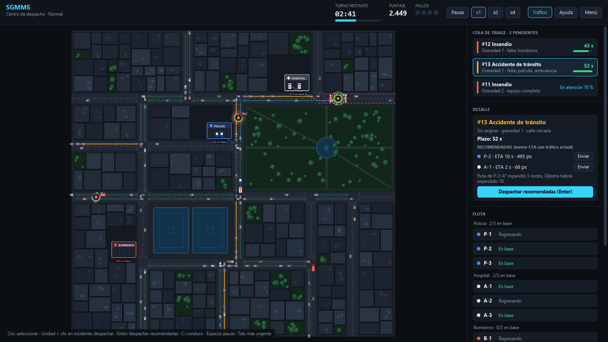
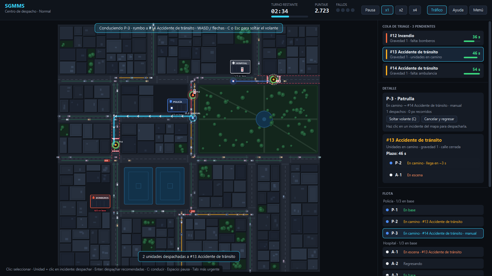
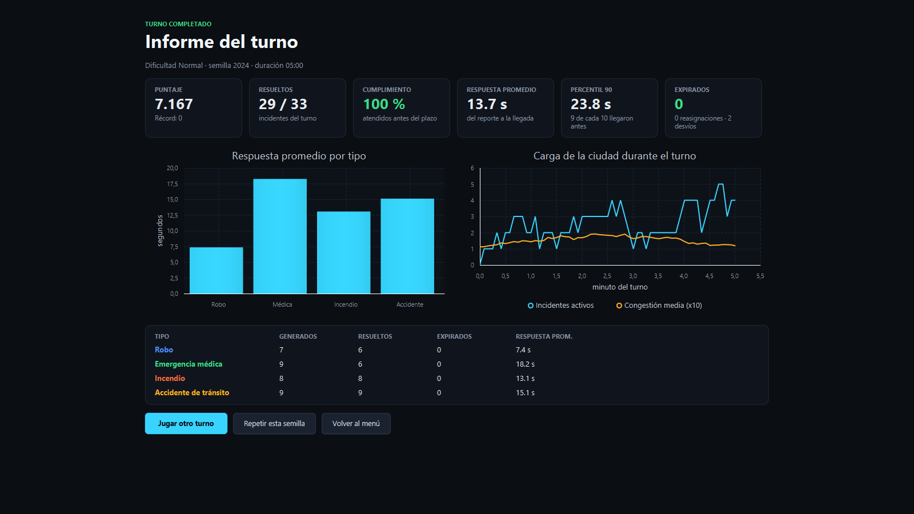
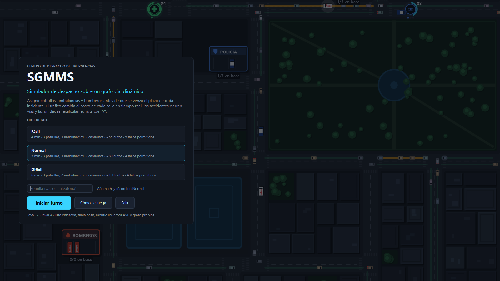

# SGMMS · Simulador de despacho de emergencias

Simulador de escritorio en **Java 17 + JavaFX** donde operas el centro de despacho de una ciudad: llegan robos, emergencias médicas, incendios y accidentes, y tienes que decidir qué patrulla, ambulancia o camión de bomberos enviar antes de que se venza el plazo de cada incidente.

La ciudad es un **grafo vial dinámico**: el costo de cada calle cambia en tiempo real según la congestión de los autos civiles, los accidentes cierran vías y las unidades recalculan su ruta con **A\*** mientras se mueven. Todo el motor está separado de la interfaz, es determinista con semilla y viene con pruebas y un benchmark que mide el efecto de cada decisión de diseño.



## Lo que tiene de particular

| | |
|---|---|
| **Grafo con pesos vivos** | Cada carril es una arista dirigida cuyo peso es `longitud / (velocidad × factor de congestión)`. La ocupación la actualiza el tráfico civil en cada paso, y un accidente cierra la calle en ambos sentidos hasta que se resuelve. |
| **A\* con orígenes y destinos múltiples** | Los vehículos casi nunca están parados en una esquina: una unidad a mitad de cuadra puede seguir o dar la vuelta en U, y un incidente a mitad de cuadra se alcanza desde cualquiera de sus dos esquinas. El buscador recibe semillas con costo inicial y costo final, y la heurística (distancia en línea recta × cota inferior de segundos por píxel) nunca sobreestima. |
| **Replanificación con histéresis** | Las unidades recalculan la ruta cada 2.5 s y apenas se abre o cierra una calle, pero solo cambian de camino si el ahorro supera un margen. Sin esa histéresis cambiaban de idea con cada fluctuación del tráfico y perdían tiempo. |
| **Triage con árbol AVL** | Los incidentes pendientes se ordenan por plazo límite (*earliest deadline first*) en un AVL propio. El mínimo es el más urgente y el recorrido en orden es la cola que ve el operador. |
| **Tráfico con seguimiento vehicular** | Cada auto civil sigue al de adelante, espera espacio para entrar a la siguiente cuadra, recalcula su ruta en cada esquina, se orilla ante una sirena y se devuelve si queda atrapado detrás de un accidente. |
| **Simulación determinista y sin hilos** | Paso fijo de 1/60 s dentro de un `AnimationTimer`; no hay un hilo por entidad. Con la misma semilla el turno es idéntico, lo que permite pruebas reproducibles y comparar estrategias de forma justa. |
| **Métricas operativas** | Tiempo de respuesta promedio y percentil 90 (ordenando con el montículo propio), cumplimiento de plazos, reasignaciones, desvíos y evolución de la carga durante el turno. |

## Cómo se juega

- **Despachar:** haz clic en un incidente para ver las unidades recomendadas con su ETA calculado sobre el tráfico actual y presiona **Enter**, o selecciona una unidad y haz clic en el incidente.
- **Reasignar:** una unidad que va en camino se puede desviar a un incidente más urgente o mandar de regreso.
- **Tomar el volante:** selecciona una unidad y presiona **C** para conducirla con **WASD** o las flechas, guiado por la línea del GPS. Manejando te saltas la congestión, pero chocar con un auto te frena.
- **Reglas:** el robo pide una patrulla, la emergencia médica una ambulancia y el incendio bomberos (dos camiones si llega a gravedad 3). El accidente pide patrulla y ambulancia, y además cierra la calle. Un incendio que pasa la mitad de su plazo sin bomberos se propaga. Cada incidente vencido es un fallo, y al llegar al límite de fallos el turno termina.
- **Atajos:** Espacio pausa · 1/2/3 velocidad · Tab siguiente urgente · T capa de tráfico · F12 captura · H ayuda.

| Conducción manual con GPS | Informe de fin de turno |
|---|---|
|  |  |



## Arquitectura

```
sgmms
├── estructuras   ListaEnlazada, TablaHash, MonticuloMin, ArbolAVL (sin java.util.*)
├── grafo         Nodo, Via (arista con ocupación y cierres), Grafo, FuncionCosto, BuscadorRutas (A* / Dijkstra)
├── modelo        Unidad, Incidente, Estacion, VehiculoCivil, Plan, Tramo, PuntoVia, enums de tipos y estados
├── simulacion    Simulacion (motor), Ciudad, Navegador, Trafico, Metricas, Estrategia, Benchmark
└── ui            App, VistaMenu, VistaJuego, VistaInforme, Renderizador, PlanoCiudad, Iconos
```

`simulacion` no importa nada de JavaFX: la interfaz solo lee el estado y envía órdenes (`asignar`, `tomarControl`, `ordenarRegreso`…). Por eso el mismo motor corre en el juego, en las pruebas y en el benchmark.

| Estructura | Dónde se usa |
|---|---|
| Lista doblemente enlazada | Flota, tráfico, incidentes, rutas, bitácora |
| Tabla hash (encadenamiento, redimensiona a 0.75) | Adyacencia del grafo; costos, predecesores y visitados de cada búsqueda; ocupantes de cada carril |
| Montículo binario de mínimos | Frontera de A\* y Dijkstra; heapsort para percentiles |
| Árbol AVL | Cola de triage ordenada por plazo |

## Resultados del benchmark

Turnos completos sin interfaz con despacho automático, 20 semillas por dificultad, comparando dos estrategias sobre los mismos incidentes:

- **Estática:** elige la unidad más cercana en línea recta y planifica solo por distancia; replanifica únicamente ante cierres.
- **Dinámica:** elige la unidad con menor ETA según A\* con el tráfico actual y replanifica en ruta.

| Dificultad | Estrategia | Respuesta prom. | P90 | Cumplimiento | Expirados/turno |
|---|---|---|---|---|---|
| Normal | Estática | 15.5 s | 27.3 s | 97.2 % | 0.85 |
| Normal | Dinámica | 15.2 s | 26.5 s | 97.6 % | 0.70 |
| Difícil | Estática | 18.8 s | 33.1 s | 89.8 % | 4.30 |
| Difícil | Dinámica | 18.5 s | 32.7 s | 89.0 % | 4.60 |

**Lectura honesta:** en esta ciudad, tener en cuenta el tráfico mejora la respuesta solo entre 1.6 y 2.1 %, y en Fácil no mejora. Medí la causa: las unidades conservan en promedio el 75 % de su velocidad libre, y en una cuadrícula cualquier desvío agrega una cuadra entera, que cuesta más de lo que ahorra esquivar un trancón corto. Lo que sí es contundente es el costo de calcular las rutas:

> En 2000 rutas sobre la red real a mitad de turno, **A\* expande entre 43 y 52 % menos nodos que Dijkstra** y encuentra el mismo costo óptimo en el 100 % de los casos.

## Ejecutar

Requisitos: **JDK 17 o superior**. Maven es opcional porque el repositorio incluye el wrapper.

```bash
./mvnw javafx:run            # Linux / macOS / Git Bash
mvnw.cmd javafx:run          # Windows (requiere JAVA_HOME)
```

```bash
./mvnw test                  # 52 pruebas: estructuras, búsquedas, navegador, tráfico y escenarios completos
./mvnw -q compile && java -cp target/classes sgmms.simulacion.Benchmark 20 NORMAL
```

Las capturas de este README se generan solas recorriendo la aplicación:

```bash
java --module-path <jars de JavaFX> --add-modules javafx.controls -Dsgmms.capturas=docs/img -cp target/classes sgmms.ui.Lanzador
```

## Origen

Parte de la *Tarea Integradora 2* de Algoritmos y Programación II (Universidad Icesi, 2025), hecha en equipo de tres. Aquella versión quedó incompleta: los incidentes no se veían ni se podían resolver y las estructuras de datos no estaban conectadas al juego. De ella se conservan la idea (atender incidentes con el vehículo correcto en una ciudad modelada como grafo) y el trazado de calles del mapa. Todo lo demás se rediseñó y escribió de nuevo: el motor de simulación, el tráfico, el despacho, las estructuras, la interfaz y las pruebas. La ciudad y los vehículos se dibujan con gráficos vectoriales en lugar de los sprites originales.
